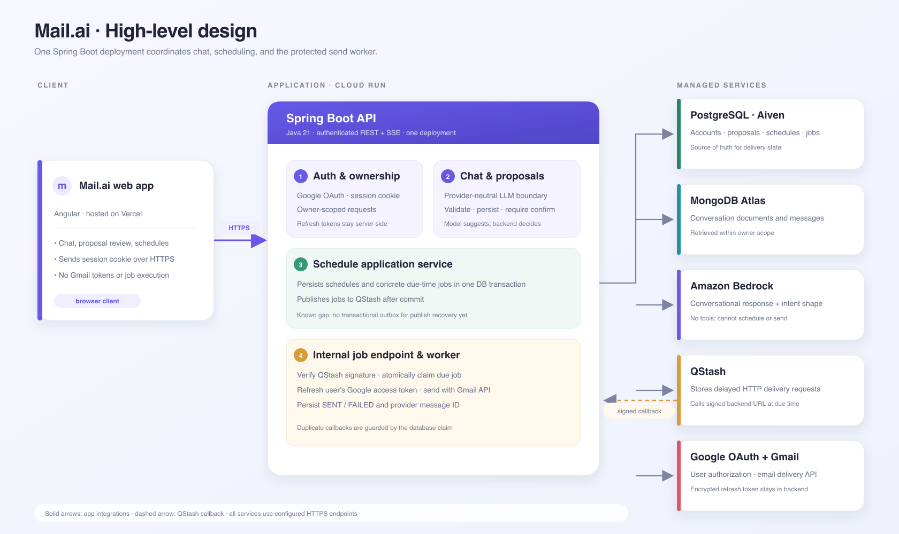
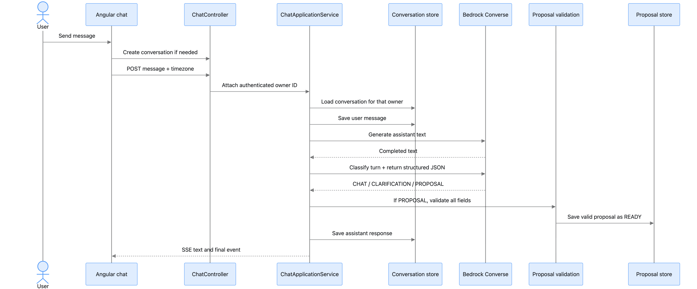
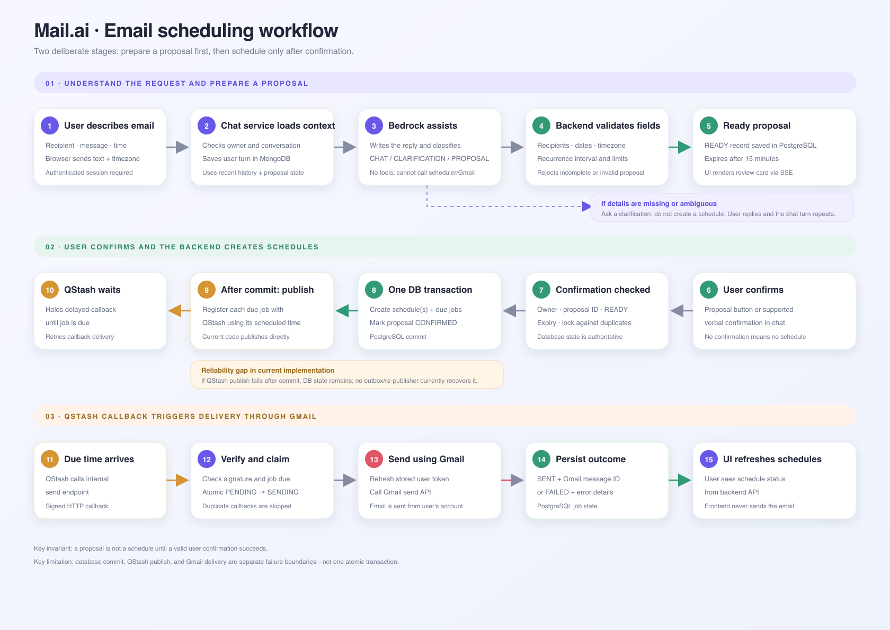

# mail.ai

Cloud-hosted prototype for scheduling Gmail messages. The Schedule API and internal QStash callback run in one Spring Boot application. Jobs are internal and are not returned by the user-facing API.

The Angular frontend is maintained in the separate [mail-ai-web repository](https://github.com/Mangesh1511/mail-ai-web). Locally, it discovers the backend's selected port through the health endpoint.

## Architecture diagrams

### High-level design



### Chat request and proposal sequence



### End-to-end email workflow



## Prerequisites

- Docker Desktop with Docker Compose
- Java 21 and Maven 3.9+ only for the optional H2 backend mode
- For the complete chat-and-email flow: a Google OAuth Web client and an Amazon Bedrock bearer API key

## Start the full local stack

The recommended setup runs PostgreSQL, MongoDB, QStash, and Spring Boot in Docker. MongoDB and PostgreSQL health checks must pass before the app container starts. The script reads `.env`, starts QStash's local development server, captures its temporary signing credentials into the ignored `.local/` directory, builds the backend image, then checks `/api/health`.

```bash
# Source from the repository root. This defines start_app, stop_app, and app_logs.
source ./buildenv.bash
start_app
```

You can source `buildenv.bash` by its full path from another directory too. The first `start_app` creates `.env` from `.env.example` when needed, then pauses for configuration. Set `GOOGLE_CLIENT_ID`, `GOOGLE_CLIENT_SECRET`, and `AWS_BEARER_TOKEN_BEDROCK` to credentials you provide; the full-stack startup requires all three. The helper locates the repository itself, so you do not need to `cd` into it first.

If `TOKEN_ENCRYPTION_KEY` is blank, the script creates a local 32-byte key and stores it in `.env`. Before connecting Gmail, configure a Google OAuth Web application and add `http://localhost:8082/auth/google/callback` as an authorized redirect URI. The backend is available at `http://localhost:8082`.

The full local chat-and-email flow needs your own Google OAuth credentials and Amazon Bedrock bearer API key. These are not included in the repository. Without those credentials, use the minimal H2 mode for backend-only work; it does not provide the full MongoDB, QStash, Bedrock, and Gmail flow.

In a second terminal, clone and start the frontend:

```bash
git clone https://github.com/Mangesh1511/mail-ai-web.git
cd mail-ai-web
npm ci
npm start
```

Open `http://localhost:4201`. For frontend-specific requirements and deployment configuration, see the frontend repository README.

Before the first containerized start, stop any host-run Spring, QStash, MongoDB, or PostgreSQL processes that already occupy ports 8080–8082, 27017, or 5432. The script detects occupied ports and reports them before starting the stack.

Stop containers with `stop_app` or `docker compose down`. Both preserve PostgreSQL and MongoDB volumes. Use `docker compose down -v` only when you intend to delete local database data. The QStash development server keeps messages in memory, so local schedules reset if that container is recreated. Local callbacks route to the app through the Compose network.

For backend logs, run `app_logs`. For dependency logs, run `docker compose logs mongodb postgres qstash`.

## Minimal backend only (H2)

```bash
cd mail.ai/server
mvn spring-boot:run
```

This lightweight mode uses in-memory H2 and does not start MongoDB or QStash. Use it for backend-only API work; chat persistence and delayed delivery require the full local stack above.

## Build

From `mail.ai/server`:

```bash
mvn -DskipTests package
java -jar target/mail-ai-server-0.1.0-SNAPSHOT.jar
```

## Configure integrations

Set these variables in the environment where the server runs. Do not commit `.env` or real credentials.

| Variable | Needed for | Notes |
| --- | --- | --- |
| `GOOGLE_CLIENT_ID` | Google OAuth | OAuth client ID from Google Cloud |
| `GOOGLE_CLIENT_SECRET` | Google OAuth | OAuth client secret |
| `SERVER_PORT` | Local server | Optional explicit port; if unset, the app picks the first available port from 8080 through 8082 |
| `GOOGLE_REDIRECT_URI` | Google OAuth | Optional override; by default it follows the selected server port |
| `TOKEN_ENCRYPTION_KEY` | Storing Gmail refresh tokens | Base64 encoding of exactly 32 random bytes; used for AES-256-GCM |
| `QSTASH_ENABLED` | Delayed job triggering | Defaults to `false`; set `true` to register delayed QStash callbacks |
| `QSTASH_URL` | QStash publishing | Use `http://localhost:8080` for the local development server; defaults to the hosted QStash API |
| `QSTASH_TOKEN` | QStash publishing | QStash API token |
| `QSTASH_CURRENT_SIGNING_KEY` | Callback verification | Current QStash signing key |
| `QSTASH_NEXT_SIGNING_KEY` | Callback verification | Next/rotation signing key; optional until key rotation |
| `PUBLIC_BASE_URL` | QStash callback | Public HTTPS origin in deployment. Locally, defaults to `http://localhost:<selected-port>` |
| `AI_PROVIDER` | AI chat | Set to `bedrock-converse` to enable Amazon Bedrock Converse; defaults to `none` so the scheduler starts without AI credentials |
| `AWS_BEARER_TOKEN_BEDROCK` | AI chat | Amazon Bedrock API key used as a bearer token; keep it in local `.env` or a deployment secret store |
| `AWS_REGION` | AI chat | Bedrock region; defaults to `us-east-1` |
| `AI_MODEL` | AI chat | Bedrock model ID; defaults to `us.anthropic.claude-sonnet-4-6` |
| `CHAT_STORE` | Conversation history | `memory` for local development, or `mongo` to persist conversations in MongoDB |
| `MONGODB_URI` | MongoDB conversation store | Mongo connection URI; used when `CHAT_STORE=mongo` |
| `CHAT_PROPOSAL_STORE` | Schedule proposal persistence | Defaults to relational JPA storage; use `memory` only for local experiments |

For deployment, the app must be reachable from hosted QStash over HTTPS, Google OAuth must be configured and authorized, and QStash must be enabled. The local QStash container in this setup is for development and testing only. See [Upstash's local development guide](https://upstash.com/docs/qstash/howto/local-development) for behavior and limitations.

The backend calls Bedrock's Converse endpoint over HTTP and sends `AWS_BEARER_TOKEN_BEDROCK` as an `Authorization: Bearer` token. This matches the working Bedrock API-key request and does not use the AWS SDK credential-provider chain, IAM profiles, or access-key/secret-key environment variables. Keep the token only in your local `.env` or deployment secret store. AWS short-term Bedrock API keys expire with the console session (up to 12 hours), so refresh the token and restart the app when one expires. See [AWS Bedrock API key usage](https://docs.aws.amazon.com/bedrock/latest/userguide/api-keys-use.html).

## API overview

All schedule endpoints require the Google OAuth session cookie.

- `GET /api/health` — health status for the app, relational database, and MongoDB when Mongo conversation storage is enabled; no authentication required.
- `GET /auth/google` — begin Gmail account connection.
- `GET /auth/google/callback` — OAuth redirect endpoint; normally called by Google.
- `POST /auth/logout` — end the current app session without revoking Google access.
- `POST /api/schedule/fixed` — create one future send.
- `POST /api/schedule/recurrence` — create elapsed-time recurrence.
- `GET /api/myschedules` — list the signed-in user's schedules.
- `POST /api/chat/conversations` — create an authenticated assistant conversation.
- `GET /api/chat/conversations` — list the signed-in user's conversations.
- `GET /api/chat/conversations/{id}` — load an owned conversation.
- `POST /api/chat/conversations/{id}/messages` — stream assistant text and a validated schedule proposal over SSE.
- `POST /api/chat/proposals/{id}/confirm` — confirm an owned proposal and create the schedule through the existing service.
- `POST /internal/jobs/{jobId}/send` — internal QStash callback; requires a valid QStash signature.

Example request body for fixed scheduling:

```json
{
  "recipients": ["person@example.com"],
  "subject": "Scheduled message",
  "body": "Message text",
  "sendAt": "2026-10-02T15:00:00Z",
  "timezone": "Asia/Kolkata"
}
```

Example request body for hourly recurrence:

```json
{
  "recipients": ["person@example.com"],
  "subject": "Recurring message",
  "body": "Message text",
  "startAt": "2026-10-02T15:00:00Z",
  "endAt": "2026-10-03T15:00:00Z",
  "intervalSeconds": 3600,
  "timezone": "Asia/Kolkata"
}
```

Times are supplied as ISO-8601 instants; `timezone` is retained as schedule context. Schedule horizon is limited to seven days and recurrence is at least hourly.

## Project documentation

- `docs/design.md` — high-level design, workflow, component details, and interview preparation.
- `AGENTS.md` — project-specific development guidance.

For frontend-specific requirements and deployment configuration, use the `mail-ai-web` repository README.
