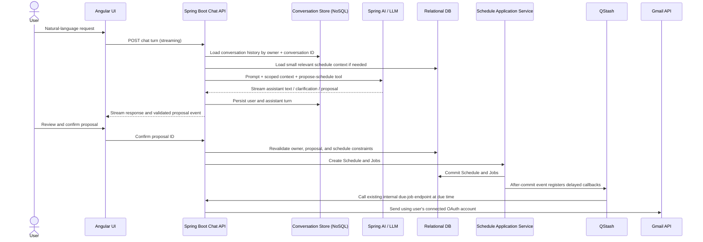

# AI Scheduling Integration — Low-Level Design

## 1. Goal

Let an authenticated user describe one or more Gmail messages in natural language, review a validated schedule proposal, and explicitly confirm it. The existing scheduler remains responsible for persistence, QStash registration, and Gmail delivery.

Example: “Send these ten messages every six minutes between 3 and 4 PM tomorrow” should become a proposal with ten concrete due times, not an instruction for the model to call Gmail or QStash directly.

## 2. Design decisions

- Add a streaming chat API to the existing Spring Boot app for the Angular UI.
- Use Spring AI `ChatClient` and a configured model provider. The LLM interprets requests and proposes structured data; application code validates and executes confirmed actions.
- Keep the current Schedule REST endpoints and `ScheduleApplicationService` as the single schedule-creation path.
- Require explicit user confirmation before creating any Schedule or Job. No model tool directly sends email, persists schedules, or registers QStash deliveries.
- Persist chat conversations and messages in a document-oriented NoSQL store for conversational context. Keep schedules, jobs, Gmail accounts, ownership, and delivery state in the existing relational database.
- Do not copy schedule data into the chat document store. Fetch relevant schedules from the relational store when context is needed; chat history is not the source of truth for schedule state.
- Store provider/model configuration and chat persistence behind interfaces so a provider or storage backend can be changed later.

## 3. Runtime architecture



## 4. Components and package layout

Add packages under `com.example.scheduler`:

- `chat.api`
  - `ChatController`: authenticated conversation endpoints; maps HTTP/SSE requests and responses.
  - Request/response records for create/list/send/confirm operations.
- `chat.application`
  - `ChatApplicationService`: authorizes owner, loads conversation, invokes AI, stores turns, orchestrates proposal lifecycle.
  - `ScheduleProposalService`: deterministic validation and proposal persistence.
  - `ProposalConfirmationService`: verifies ownership/expiry/one-time use, then calls `ScheduleApplicationService`.
- `chat.ai`
  - `ScheduleAssistant`: Spring AI prompts and streamed response/classification calls.
  - `ScheduleAssistantSystemPrompt`: concise behavioral and safety instructions.
- `chat.domain`
  - Domain records/enums for proposals and conversation events where they are not persistence-specific.
- `chat.persistence`
  - `ConversationStore` interface and NoSQL implementation/repository.
  - `ScheduleProposalStore` interface and implementation; proposal persistence may initially be in the same NoSQL conversation document, or relational if transactional ownership/consumption checks require it. Recommendation below selects NoSQL for conversation only and relational DB for proposals.

Existing `ScheduleApplicationService`, `ScheduleRepository`, `EmailJobRepository`, `JobSchedulingListener`, `QStashPublisher`, and Gmail sender remain the execution pipeline.

## 5. Data model

### 5.1 Existing relational entities (unchanged)

`Schedule` remains authoritative for user-approved instruction:

- `id: UUID`
- `ownerId: String`
- `type: FIXED | RECURRENCE`
- `state: ACTIVE | ...`
- `recipients: List<String>`
- `subject`, `body`
- `timezone: ZoneId`
- `startAt`, `endAt`, `intervalSeconds`
- `createdAt`

`EmailJob` remains authoritative for each concrete delivery occurrence:

- `id: UUID`, `scheduleId`, `dueAt`
- `state: PENDING | SENDING | SENT | FAILED`
- `createdAt`, `startedAt`, `completedAt`
- `lastError`, `gmailMessageId`

The existing unique `(schedule_id, due_at)` and due/schedule indexes continue to apply.

### 5.2 NoSQL `Conversation` document

Suggested MongoDB document, keyed by conversation ID:

```json
{
  "_id": "conversation UUID",
  "ownerId": "authenticated app owner ID",
  "title": "Email to team tomorrow",
  "createdAt": "UTC instant",
  "updatedAt": "UTC instant",
  "messages": [
    {
      "id": "message UUID",
      "role": "USER | ASSISTANT | TOOL",
      "content": "message text or concise tool result",
      "createdAt": "UTC instant",
      "status": "COMPLETE | INTERRUPTED | FAILED"
    }
  ],
  "expiresAt": "optional retention deadline"
}
```

Indexes:

- Unique/primary `_id`.
- Compound `{ ownerId: 1, updatedAt: -1 }` for listing a user's conversations.
- TTL on `expiresAt` only if a retention policy is selected; do not enable an implicit TTL without defining user-facing retention.

Store only conversation text needed to continue the dialogue and compact tool summaries. Do not store OAuth tokens, QStash credentials, raw provider secrets, or duplicate job state. Limit message size and conversation length; summarize or archive old context rather than sending the entire transcript to the LLM indefinitely.

### 5.3 Relational `ScheduleProposal` entity

Persist proposals in the relational database so confirmation is owner-scoped, atomic, and auditable:

- `id: UUID`
- `ownerId: String`
- `conversationId: String/UUID`
- `status: DRAFT | READY | CONFIRMED | REJECTED | EXPIRED`
- `proposalJson: JSON/JSONB` — normalized schedule intent and, for batches, child message intents and concrete due instants.
- `validationErrors: JSON/JSONB` or normalized error list.
- `createdAt`, `expiresAt`, `confirmedAt`
- `createdScheduleIds: JSON/JSONB` or relation table for one-to-many schedule creation.
- `version` for optimistic concurrency / one-time confirmation.

Indexes: `(owner_id, created_at)` and `(conversation_id, created_at)`. Confirmation is a conditional transition from `READY` to `CONFIRMED`, scoped by both proposal ID and authenticated owner. Replays must not create schedules again.

Relational proposals are intentionally separate from chat history. The NoSQL conversation is conversational context; the relational proposal is a validated, confirmable command.

### 5.4 Proposal payload

Use an application-owned schema; never accept arbitrary model-generated persistence fields:

```json
{
  "kind": "BATCH_FIXED | FIXED | RECURRENCE",
  "timezone": "America/Los_Angeles",
  "messages": [
    {
      "recipients": ["person@example.com"],
      "subject": "...",
      "body": "...",
      "sendAt": "UTC instant"
    }
  ],
  "recurrence": null
}
```

For recurrence, include `startAt`, `endAt`, and `intervalSeconds` under `recurrence`. Batch proposals materialize each individual email as a fixed schedule unless product semantics explicitly define a single schedule with multiple messages. All instants must be resolved with an explicit timezone and ambiguity handling.

## 6. API contract

All routes require the existing authenticated app session; derive `ownerId` server-side. Do not trust an owner ID supplied in JSON.

- `POST /api/chat/conversations` — create conversation; returns its ID.
- `GET /api/chat/conversations` — list current user's conversations and metadata.
- `GET /api/chat/conversations/{id}` — get bounded message history after owner check.
- `POST /api/chat/conversations/{id}/messages` — accept user text and stream assistant events using SSE or streaming HTTP.
- `POST /api/chat/proposals/{id}/confirm` — confirm a `READY` proposal, create schedules once, and return resulting Schedule responses.
- `POST /api/chat/proposals/{id}/reject` — mark proposal rejected.

Stream event types:

- `text_delta`: user-facing incremental assistant text.
- `proposal`: validated proposal preview with proposal ID, expiry, and normalized schedule details.
- `clarification`: question when required information is missing or ambiguous.
- `error`: safe user-facing error code/message.
- `done`: stream completion.

The proposal event is not itself confirmation. The UI must require a user action before calling confirm.

## 7. LLM/tool design

For the initial version, expose **no action tools** to the model. The backend streams a conversational response and then makes a constrained structured classification call against the same user turn and bounded conversation context. It accepts only ordinary chat, clarification, or a fixed/batch/recurrence proposal. The backend validates and stores a valid proposal; only the separate authenticated confirmation endpoint can create Schedule/Job records. Do not expose `sendEmail`, `publishToQStash`, raw repositories, or arbitrary HTTP calls. A read-only schedule lookup can be added later with strict server-side owner scoping.

The model may ask for missing details. Relative dates such as “tomorrow” must be resolved using the authenticated user's configured timezone (or ask for one); never assume UTC/local host timezone. “At 9 PM” without a date is ambiguous and must trigger clarification unless the product explicitly chooses the next occurrence rule.

Prompt injection in email text or prior chat must not expand tool permissions. Treat user content as data. Tool DTOs have strict validation and size/count caps; application code checks all recipient formats, subject/body lengths, allowed horizon, interval, batch count, and due time before rendering a proposal.

## 8. Context and retention

- Load a bounded tail of the current conversation, not every conversation for the user.
- Include only relevant schedule summaries if the user asks “what did I schedule?”; query the relational database by authenticated owner and return concise data.
- Store conversation history in NoSQL because it is document-shaped and accessed as a conversation aggregate.
- Do not use NoSQL as a substitute for Schedule/Job relational state or as an unbounded dump of every prompt and model response.
- Define retention/deletion UX before setting TTL. Support deletion of a conversation and remove/expire its data according to the chosen policy.
- Keep model provider request/response logging minimized; redact recipients/message bodies from routine logs.

## 9. Error handling and safety

- Invalid structured model output: reject candidate, ask model to repair or ask user for clarification; never create schedule.
- Domain validation errors: return specific field errors in proposal event; let user edit/clarify.
- Model timeout/provider error: emit safe error event and persist interrupted/failed assistant message state.
- Confirm called twice: idempotent response returns already-created schedule IDs; do not duplicate schedules.
- Proposal expired or belongs to another user: reject; no side effects.
- Schedule creation fails before database commit: transaction rolls back and no QStash event fires.
- QStash publication failures retain the existing known reliability gap until outbox/reconciliation work is added.
- Gmail delivery remains the existing QStash callback flow and state machine.

## 10. Non-functional requirements

- Authenticate every conversation and proposal operation; enforce owner scope at each repository boundary.
- Use HTTPS in deployment; secure cookies; secrets only in secret configuration.
- Bound request, transcript, tool output, proposal batch count, and stream duration.
- Persist an idempotency/consumption state for confirmation.
- Add metrics for LLM latency/errors, tool calls, proposal validity, confirmation rate, and streaming disconnects; avoid logging message content.
- Start with a single model/provider and a modest context window; provider abstraction can be added without changing schedule domain services.

## 11. Delivery sequence

1. Confirm model provider, per-user timezone source/default, NoSQL provider, and conversation retention requirements.
2. Add NoSQL connection/configuration and `ConversationStore` plus owner-scoped conversation APIs.
3. Add provider starter/configuration and a streaming chat service without side-effecting tools.
4. Add schedule proposal schema, deterministic validation, relational proposal persistence, and preview UI.
5. Add owner-scoped, idempotent confirmation wired to existing schedule application service.
6. Add read-only schedule-context capability if needed; verify it scopes strictly to the current owner.
7. Validate the entire UI → proposal → confirmation → database → QStash → Gmail path with configured integration credentials.

## 12. Open product decisions

- Which LLM provider/model and secret/configuration mechanism?
- Which NoSQL service is available in the target cloud (MongoDB Atlas, DynamoDB, or another managed store)?
- Conversation retention and user deletion behavior?
- User timezone profile field and how to set it if unknown?
- Should “10 emails over one hour” mean 10 fixed messages with one shared draft/content, or 10 independently specified messages? Require the assistant to clarify recipients/content when the instruction is underspecified.
- Should a batch confirmation create N independent schedules or one parent campaign entity? MVP recommendation: one proposal with N fixed schedules and link them to its proposal/conversation for audit.
